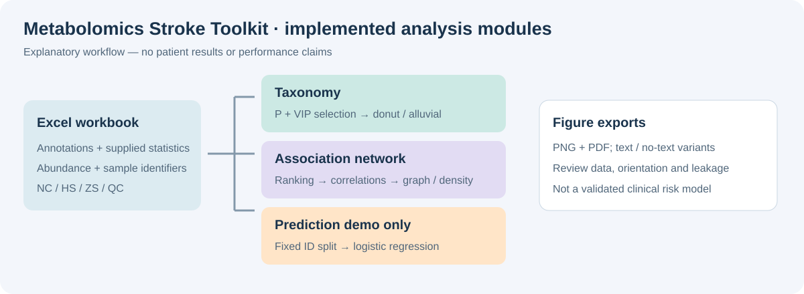
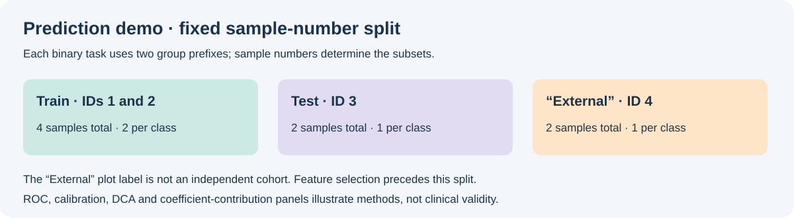

# Metabolomics Stroke Prediction Toolkit

**Chemical taxonomy visualization, exploratory association networks, and prediction-method demonstration for ocular-discharge metabolomics.**

This Python toolkit organizes supplied metabolomics tables into taxonomy figures, network views, and illustrative prediction panels. The current prediction code performs binary group classification; it does not implement prospective stroke incidence prediction or a validated clinical risk calculator.

[Related hosted application](https://stroke-cdss-xuwang.streamlit.app/) · [Source](src/metabolomics_stroke) · [Example configuration](examples/example_config.json)

The hosted application was linked in the original README. This folder contains command-line tools, not its Streamlit application source; deployment availability and equivalence to this code are not established here.



*Explanatory schematic, not experimental results. Read the implementation-status notes below before running the network or prediction modules.*

## 1. Functional modules

| Command | Function | Current status |
|---|---|---|
| ms-load | Load two comparison sheets and merge their abundance columns | Implemented; inspect merge behavior and sample consistency |
| ms-taxonomy | Filter supplied statistics and draw taxonomy figures | Implemented; requires populated annotation columns and a nonempty selected set |
| ms-network | Rank metabolites and draw correlation/network and class-density figures | Implemented with a matrix-orientation issue described below |
| ms-predict-demo | Generate binary logistic-regression evaluation and contribution panels | Demo only; currently missing a required import |
| ms-diff | Differential analysis | Placeholder that prints a message; no differential tests are performed |

### Chemical taxonomy

The selection rule is **p-value < p_thr AND VIP ≥ vip_thr**, defaulting to 0.05 and 1.0. Statistics are read from the workbook; the toolkit does not estimate VIP or recompute differential p-values.

- Nested donut: **outer ring = Super Class, middle = Class, inner = Sub Class**.
- Alluvial-style figure: **Super Class → Sub Class → Regulation**.
- Regulation is standardized to Up/Down; other values are excluded from alluvial flows.
- The largest subclasses are retained; remaining subclasses are grouped into Other in the alluvial view.
- Each input row contributes one count. These plots show selected-row composition, not abundance-weighted enrichment or pathway significance.
- Figures are exported both with and without labels, in PNG and PDF.

The alluvial implementation uses weighted curved lines rather than filled, area-calibrated Sankey ribbons. Unlabeled variants are intended for subsequent figure assembly, not standalone interpretation.

### Association network

The intended workflow ranks metabolites by VIP, ascending p-value, or absolute log2FoldChange, selects Top-N, computes Spearman associations, and applies an absolute-correlation threshold.

Network nodes are colored by Class and sized by VIP; edges use absolute correlation for inclusion and width. Positive and negative associations are not visually distinguished. The chord-like view summarizes between-class edge density, with up to 40 nonzero class pairs displayed; it is not a biochemical reaction map.

**Current orientation issue:** the CLI creates a samples × metabolites matrix, but spearman_corr transposes it before calling pandas corr(). The resulting correlation matrix is therefore sample × sample, not metabolite × metabolite. Annotation dictionaries are keyed by metabolite names, so these sample nodes generally lack the intended annotations. Correct and verify orientation before interpreting any output as a metabolite network.

The selected sheet's columns beginning with NC/HS/ZS/QC are included; QC is not automatically removed. Mixed groups can induce correlations through group differences. No edge p-values, multiple-testing correction, or network stability estimates are implemented.

The threshold targets an approximate edge count and is clipped to rho_min/rho_max; target_edges is not an exact guarantee. Near-perfect correlations are excluded while choosing the threshold but can still enter the final graph.

### Prediction panels: methods demonstration

The module creates ROC, precision–recall, calibration, decision-curve, coefficient-contribution bars, and individual contribution panels for:

| Task | Positive class |
|---|---|
| HS vs NC | HS |
| HS vs ZS | HS |
| ZS vs NC | ZS |

Features are selected by VIP for the first two tasks and by absolute mean-abundance log2 fold change for ZS vs NC. The model uses train-fitted StandardScaler and L2 logistic regression (C=1, liblinear, max_iter=500).



The split is hard-coded by sample suffix: 1–2 train, 3 test, 4 “External”, per class. The quoted label does **not** establish external validation. Feature selection precedes splitting, creating potential evaluation leakage. These extremely small subsets cannot substantiate predictive performance, calibration, or clinical benefit.

Contribution values are **coefficient × standardized feature value**, not a SHAP-library calculation. The so-called waterfall is a horizontal contribution bar plot, not a cumulative baseline-to-prediction waterfall. Decision curves pool the test and ID-4 subsets; calibration uses two quantile bins.

**Current blocker:** predict_demo.py uses re.match without importing re, so the prediction function raises NameError before fitting. This README documents the current implementation; it does not claim that the demo runs successfully as shipped.

## 2. Installation

Use a dedicated Python environment (package metadata specifies Python ≥3.9).

```bash
git clone https://github.com/shumao469/stroke.git
cd stroke/tools/Metabolomics_Stroke_Prediction_Toolkit
python -m venv .venv
```

Activate it:

- Windows PowerShell: `.\.venv\Scripts\Activate.ps1`
- Linux/macOS/WSL: `source .venv/bin/activate`

Then:

```bash
python -m pip install --upgrade pip
python -m pip install -r requirements.txt
python -m pip install --no-deps -e .
ms-taxonomy --help
```

**Packaging caveat:** setup.cfg currently places all install_requires entries on one line, which may be rejected by setuptools even with --no-deps. If editable installation fails, install requirements and run command functions directly from the source folder:

```bash
cd src
python -c "from metabolomics_stroke.cli import cmd_taxonomy; cmd_taxonomy()" --help
```

Replace --help with the command's normal arguments; use an absolute workbook/output path. The same pattern works for cmd_load and cmd_network. It does not resolve module-specific issues described above. No installation or full analysis run is asserted by this documentation update.

## 3. Workbook format

The Excel workbook is user-supplied; no example patient dataset is bundled.

| Sheet role | Default sheet name |
|---|---|
| Abundance / statistics: HS vs NC | HS-vs-NC_差异表达矩阵(未筛选) |
| Abundance / statistics: ZS vs HS | ZS-vs-HS_差异表达矩阵(未筛选) |
| Taxonomy: HS vs NC | volcano-HS-vs-NC |
| Taxonomy: ZS vs HS | volcano-ZS-vs-HS |

Use --hsnc_sheet / --zshs_sheet for load/network/prediction, and --sheet_hsnc / --sheet_zshs for taxonomy, to override names. Custom English sheet names are supported.

Expected fields:

| Field | Meaning / usage |
|---|---|
| Metabolites | Metabolite identifier; use unique, consistent identifiers across sheets |
| Super Class, Class, Sub Class | Chemical hierarchy used by taxonomy |
| Regulation | Up or Down for alluvial views |
| p-value | Supplied statistical value; numeric |
| VIP | Supplied variable-importance score; numeric |
| log2FoldChange | Required when network ranking uses absolute log2FC |
| NC1, NC2, … | Control abundance columns |
| HS1, HS2, … | Hemorrhagic-stroke abundance columns |
| ZS1, ZS2, … | Ischemic-stroke abundance columns |
| QC1, QC2, … | Quality-control abundance columns |

Prefer these exact uppercase prefixes with no whitespace. Some helpers recognize case-insensitive identifiers while downstream code uses case-sensitive matching.

The merge uses an **inner join** on Metabolites, retaining only shared metabolites. Duplicate HS/ZS/QC sample columns from both sheets are averaged per metabolite; this is not a reconciliation/QC procedure. Duplicate metabolite IDs are dropped after merging and can cause ambiguous many-to-many intermediate joins.

NC duplicate-column handling differs from the other prefixes: if NC appears in both sheets and receives merge suffixes, it may be omitted. Inspect abundance_merged.csv before downstream use.

No automatic blank correction, batch correction, normalization, missing-value imputation, multiple-testing adjustment, or patient identity validation is implemented. Prediction removes columns with missing values in the task matrix; feature identifiers absent from the merged intersection can cause selection errors.

## 4. Running the modules

Run from the toolkit directory after successful installation, or use the source-function alternative above.

### Inspect merged abundance

```bash
ms-load --excel "/path/to/workbook.xlsx" --out outputs/load
```

Review the metabolite index, sample coverage, duplicates, abundance scale, and missingness before interpreting later figures.

### Taxonomy figures

```bash
ms-taxonomy --excel "/path/to/workbook.xlsx" --out outputs/taxonomy --p_thr 0.05 --vip_thr 1.0 --top_subclass 20
```

For custom sheet names:

```bash
ms-taxonomy --excel "/path/to/workbook.xlsx" --sheet_hsnc "taxonomy_HS_NC" --sheet_zshs "taxonomy_ZS_HS" --out outputs/taxonomy
```

The selection is based on the supplied p-value column; no false-discovery-rate calculation is performed. Missing hierarchy columns or an empty selected set require input review before plotting.

### Network figures

These commands expose the implemented interface; resolve the orientation issue first.

```bash
ms-network --excel "/path/to/workbook.xlsx" --comparison HSvsNC --out outputs/network_hsnc --top_n 150 --rank_by VIP --target_edges 650 --rho_min 0.70 --rho_max 0.88
ms-network --excel "/path/to/workbook.xlsx" --comparison ZSvsHS --out outputs/network_zshs --rank_by "|log2FC|"
```

Ranking options are VIP, p, and |log2FC|. The network module selects Top-N ranked rows; it does not automatically apply the taxonomy p/VIP significance filter.

### Prediction demo

After resolving the missing import and verifying workbook/sample compatibility:

```bash
ms-predict-demo --excel "/path/to/workbook.xlsx" --out outputs/predict_demo --top_k 30
```

Each class in a task must contain IDs 1, 2, 3, and 4. Additional samples are not added to the fixed train/test/ID-4 split, though they may enter contribution plots and upstream feature selection.

Batch wrapper scripts are provided as scripts/run_all_demo.sh and scripts/run_all_demo.ps1. They call the same modules and do not repair their limitations. examples/example_config.json is an illustrative settings file; no CLI option currently loads it automatically.

## 5. Outputs

| Module | Files |
|---|---|
| Load | abundance_merged.csv |
| Taxonomy | HSvsNC_sunburst_text/notext, ZSvsHS_sunburst_text/notext; corresponding sankey variants |
| Network | Comparison + rounded threshold + network/chord + text/notext |
| Prediction | HS_vs_NC, HS_vs_ZS, ZS_vs_NC prefixes with ROC, PR, Calibration, DCA, SHAPbar_text/notext, Waterfall_text/notext |

Figure stems are exported as .png and .pdf, with a 600 dpi setting for raster output. Alluvial files are skipped when no valid Up/Down flows remain.

The CLI does not save correlation matrices, edge tables, selected-feature lists, fitted prediction models, per-sample probabilities, or a complete run manifest. Preserve the original workbook, exact command, environment versions and output provenance separately. Use a new output directory for each run.

## 6. Parameters at a glance

| Module | Setting | Default |
|---|---|---:|
| Taxonomy | --p_thr / --vip_thr | 0.05 / 1.0 |
| Taxonomy | --top_subclass | 20 |
| Network | --comparison | HSvsNC |
| Network | --top_n / --rank_by | 150 / VIP |
| Network | --target_edges | 650 |
| Network | --rho_min / --rho_max | 0.70 / 0.88 |
| Prediction | --top_k | 30 |

## 7. Troubleshooting and interpretation

| Issue | Check |
|---|---|
| Editable install fails parsing requirements | Review the one-line install_requires field; use the source-function workaround |
| Workbook sheet not found | Match default names exactly or use the relevant sheet override flags |
| Missing annotation column | Supply the hierarchy, statistics and Regulation fields required by the chosen module |
| NC samples missing after merge | Inspect duplicated/suffixed NC columns in both source sheets |
| Network nodes look like sample IDs | Current CLI/helper orientation mismatch; do not interpret as metabolite associations |
| NameError: re is not defined | Prediction demo currently lacks import re |
| KeyError selecting features/samples | Check merged metabolite intersection and required uppercase IDs 1–4 |
| Impressive ROC from tiny subsets | Treat as a figure-method demonstration, not a performance estimate |

A robust research prediction study would need patient-level cohort definitions, independent evaluation, training-only feature selection, appropriately sized calibration assessment, and uncertainty estimates. Those capabilities are not supplied by the current demo.

The existing test only checks package import/version. It does not validate workbook merging, network orientation, prediction correctness, or scientific claims.

## License and contact

See [LICENSE](LICENSE) for the included license text. For questions or contributions, open a [repository issue](https://github.com/shumao469/stroke/issues). Cite the software version/commit and methods actually used; this repository does not establish a validated ocular-discharge stroke biomarker or prospective prediction claim.
