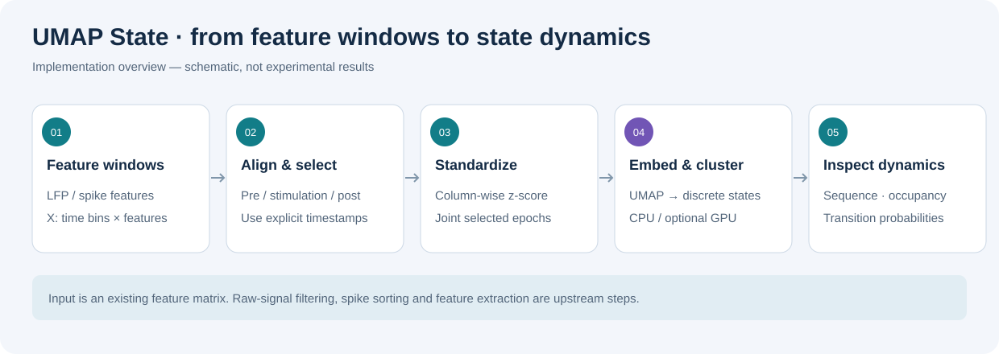

# UMAP State

**UMAP-based state-space exploration for LFP- or spike-derived feature time series.**

This Python command-line toolkit selects baseline, stimulation, and recovery epochs, standardizes features, fits a joint UMAP embedding, identifies clusters, and exports state dynamics and figures.

Input is a **precomputed feature matrix**, not raw electrophysiology. A “state” is a cluster in the embedding; its physiological meaning requires independent validation.



*Implementation overview. Both diagrams are explanatory schematics, not experimental results.*

## Features

| Capability | Current implementation |
|---|---|
| Feature input | NumPy arrays or archives containing time-bin × feature matrices |
| Epoch selection | Pre/stim/post intervals selected using timestamps or a generated feature time axis |
| Standardization | Column-wise z-score across all selected epochs together |
| UMAP | Configurable neighborhood size, minimum distance, metric, dimension, and random seed |
| CPU/GPU | CPU via umap-learn; optional RAPIDS cuML backend |
| Clustering | HDBSCAN, including noise labels, or KMeans with a specified cluster count |
| State dynamics | Label sequence, pooled occupancy, row-normalized transition probabilities |
| Visualization | Embeddings colored by state/epoch, temporal sequence, occupancy bars, transition heatmap |
| Metadata | Input paths, epoch definition, UMAP backend/settings, requested clustering settings |
| Python API | Segmentation, embedding, transformation, clustering, and dynamics functions |

Raw-signal filtering, artifact handling, spike sorting, and feature extraction are upstream steps. The CLI does not compute band power, PAC, or firing rates, provide a web GUI, run inferential statistics, or assign biological state names.

## Installation

Use **Python 3.10 or later**. Metadata declares 3.9+, but the plotting module currently uses `str | Path` annotations without postponed evaluation.

```bash
git clone https://github.com/shumao469/stroke.git
cd stroke/tools/UMAP_state
python -m venv .venv
```

Activate with `.\.venv\Scripts\Activate.ps1` in Windows PowerShell, or `source .venv/bin/activate` on Linux/macOS/WSL. Then:

```bash
python -m pip install --upgrade pip
python -m pip install -r requirements.txt
python -m pip install -e .
umap-state --help
```

Optional HDBSCAN:

```bash
python -m pip install ".[hdbscan]"
```

For GPU UMAP, configure a compatible RAPIDS cuML/CUDA environment separately and add `--gpu`. If the cuML import fails, the code silently falls back to CPU. Check `run_meta.json → umap.backend`; requesting GPU does not guarantee its use. CPU and GPU outputs need not match exactly.

## Input specification

| Input | Format |
|---|---|
| features.npy | Numeric array (T,F): time bins × features |
| features.npz | Array under key X or features; X takes precedence |
| One-dimensional input | Reshaped from (T,) to (T,1) |
| time.npy | Length-T vector in seconds, using the same coordinate system as --stim-onset |
| --fs | Feature bins per second, used only without --time |

Use finite values and chronologically ordered timestamps. The loader does not repair NaNs, infinities, artifacts, or nonmonotonic time. Keep feature definitions consistent across epochs.

A 1 s window advanced every 0.2 s produces **5 feature bins per second**, irrespective of the raw LFP sampling rate. Define whether timestamps refer to window centers or edges and apply this consistently.

## Time alignment: keep the baseline


For onset-aligned data, the example intervals are:

| Epoch | Interval |
|---|---|
| Pre | [-60,0) s |
| Stimulation | [0,180) s |
| Post | [180,780) s |

Intervals include their start and exclude their end.

**The CLI does not shift timestamps.** Without `--time`, it generates `arange(T)/fs`, starting at zero. Combining this with `--stim-onset 0` leaves no negative-time baseline.

### Option A: explicit onset-aligned timestamps

Supply a time vector containing negative baseline times and onset at zero:

```bash
umap-state --features features.npy --time time.npy --outdir outputs/session_01 --stim-onset 0 --pre-dur 60 --stim-dur 180 --post-dur 600 --cluster kmeans --kmeans-k 5 --seed 0
```

### Option B: recording starts with 60 seconds of baseline

For features sampled once per second, onset is recording time 60 s:

```bash
umap-state --features features.npy --fs 1 --outdir outputs/session_01 --stim-onset 60 --pre-dur 60 --stim-dur 180 --post-dur 600 --cluster kmeans --kmeans-k 5 --seed 0
```

This selects [0,60), [60,240), and [240,840) s. For a 0.2 s feature step, use `--fs 5`.

“10 Hz” in older example names refers to a stimulation condition, not a required feature rate or a frequency decoded by UMAP.

## Analysis workflow

1. Load features and timestamps, or generate time from the feature rate.
2. Select the three epochs; omit samples outside their intervals.
3. Concatenate selected bins in pre → stim → post order.
4. Z-score each column using all selected bins.
5. Fit one UMAP embedding to the concatenated data.
6. Cluster the embedding into integer state labels.
7. Compute pooled dynamics and save arrays, figures, and metadata.

Joint fitting puts all epochs in one embedding. Independently fitted embeddings do not share guaranteed coordinates or state identities.

This exploratory workflow uses post-stimulation data in normalization and fitting. It is not a held-out prediction pipeline; fit preprocessing and embedding on training data only when prediction is the goal.

## Parameters and clustering

| Option | Default | Purpose |
|---|---:|---|
| --n-neighbors | 30 | UMAP neighborhood size |
| --min-dist | 0.1 | Packing of embedded points |
| --metric | euclidean | Feature-space distance |
| --umap-dim | 2 | Embedding dimension |
| --seed | 0 | UMAP/KMeans random seed |
| --cluster | hdbscan | Requested clusterer |
| --min-cluster-size | 50 | HDBSCAN minimum cluster size |
| --kmeans-k | 5 | KMeans cluster count |
| --gpu | off | Request cuML UMAP |

KMeans is useful when a fixed cluster count is wanted. HDBSCAN identifies density-based groups and may label noise as **-1**.

If HDBSCAN cannot be imported, the implementation silently falls back to KMeans. Metadata records the **requested** method, so it does not establish which clusterer actually ran. Verify the dependency if HDBSCAN is required.

Keep `--umap-dim >= 2` for current plotting functions. With more dimensions, clustering uses all coordinates, but scatter plots show only the first two.

Inspect sensitivity to settings and seeds. Visual separation alone does not establish an experimental effect.

## Outputs

Files are written to `--outdir`.

| File | Contents |
|---|---|
| umap_embedding.npy | (N,D) embedding for selected bins |
| state_labels.npy | One state label per selected bin; possible -1 noise |
| segment_id.npy | 0=pre, 1=stim, 2=post |
| time_sec.npy | Selected timestamps in supplied/generated coordinates |
| umap_states.png | Embedding colored by state |
| umap_segments.png | Same embedding colored by epoch |
| state_sequence.png | State label over time |
| transition_matrix.npy/.png | Row-normalized probabilities, including self-transitions |
| state_occupancy.npy/.png | Fraction of non-noise bins assigned to each state |
| run_meta.json | Inputs, epoch settings, UMAP backend/settings, requested clusterer |

Transition/occupancy PNGs are saved only for nonempty arrays. Use a fresh output directory per run: matching files are overwritten, but stale files are not cleared.

### Interpretation details

- Occupancy is **pooled across epochs**, excludes noise, and represents bin fractions. With irregular sampling it is not a time-weighted fraction.
- Transitions are pooled across concatenated epochs; boundaries and gaps do not break the sequence.
- Noise labels are removed before transition counting. This may connect labels across noise bins, so the matrix is not strictly an immediate-next-bin estimate in that case.
- State IDs are arbitrary and cannot be matched across runs by number alone.
- UMAP coordinates have no physical units. Interpret them with the original features and temporal context.

To compute occupancy separately for each epoch:

```python
from pathlib import Path
import numpy as np
from umap_state.state import state_occupancy

out = Path("outputs/session_01")
labels = np.load(out / "state_labels.npy")
segment = np.load(out / "segment_id.npy")
valid = labels[labels >= 0]
n_states = int(valid.max()) + 1 if valid.size else 0
for i, name in enumerate(("pre", "stim", "post")):
    print(name, state_occupancy(labels[segment == i], n_states=n_states))
```

## Python API

```python
import numpy as np
from umap_state.preprocess import zscore
from umap_state.segmentation import SegmentSpec, segment_by_time
from umap_state.embed import UMAPConfig, fit_umap
from umap_state.state import ClusterConfig, cluster_states

X = np.load("features.npy")
t = np.load("time.npy")
spec = SegmentSpec(stim_onset=0, pre_dur=60, stim_dur=180, post_dur=600)
segments = segment_by_time(t, X, spec)
X_selected = np.concatenate([segments[k][1] for k in ("pre", "stim", "post")])
Xz = zscore(X_selected, axis=0)
model, Z, backend = fit_umap(Xz, UMAPConfig(random_state=0))
labels = cluster_states(Z, ClusterConfig(method="kmeans", n_clusters=5))
```

The API also supports explicit interval bounds in SegmentSpec, `transform_umap(model, X)` when supported by the backend, and `smooth_1d`. Smoothing is not applied by the CLI. When transforming new samples, apply the training-set normalization first. The CLI does not save normalization parameters or the fitted UMAP model.

## Troubleshooting

| Symptom | Check |
|---|---|
| Baseline missing | Supply negative aligned times or use the actual recording-time onset |
| Time/features mismatch | One timestamp is required per feature row |
| HDBSCAN requested but unexpected clusters | Verify HDBSCAN imports; automatic KMeans fallback exists |
| GPU requested but CPU used | Inspect the recorded UMAP backend and cuML environment |
| Unstable embedding or errors | Check finite values, sample count, neighborhood size, and feature quality |
| Plot error with dimension 1 | Use at least two embedding dimensions |
| Existing demo cannot find its data | examples/run_demo_10hz.py references examples/data/UMAP_state_space_simple.npy, which is not bundled |
| HDBSCAN labels everything noise | Inspect density settings and input data; non-noise dynamics may be empty |

## Source and further documentation

- [Implementation](src/umap_state)
- [Data specification](docs/DATA_SPEC.md)
- [Alignment background](docs/ALIGNMENT.md)
- [Additional usage notes](docs/USAGE.md): use the baseline-preserving commands above.
- [API example](examples/run_demo_10hz.py): requires your own feature file.
- [Current test](tests/test_import.py): an import smoke test, not numerical or biological validation.

## License and contact

See [LICENSE](LICENSE). Open a [repository issue](https://github.com/shumao469/stroke/issues) for questions or contributions. No project-specific paper is specified here; cite the software version/commit and methods actually used rather than a placeholder publication.
