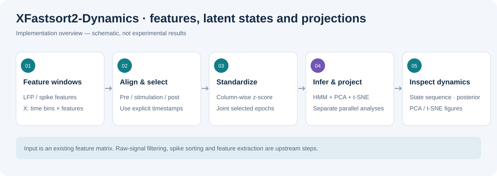
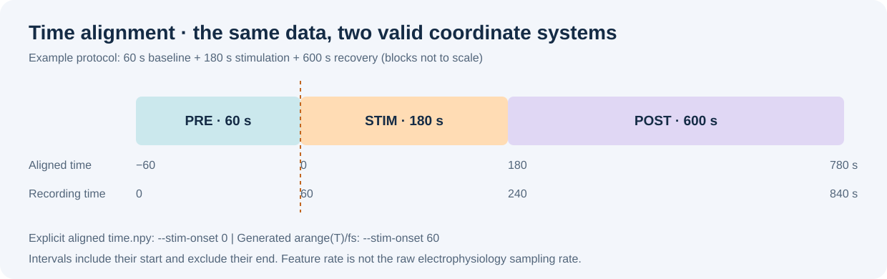

# XFastsort2-Dynamics

**Gaussian HMM state inference and PCA/t-SNE visualization for electrophysiological feature time series.**

XFastsort2-Dynamics complements spike sorting by exploring latent states across baseline, stimulation, and recovery. The installable package works on precomputed LFP- or spike-derived features. A separate Streamlit application provides interactive single-trace inspection, simple spike clustering, PAC, and spectral-feature dynamics.

[Related hosted XFastsort2.5 application](https://xfastsort2-5.streamlit.app/) · [Alignment guide](docs/ALIGNMENT.md) · [Notebook](docs/HMM_PCA_tSNE_demo.ipynb)

The hosted link points to a related application; it is not evidence that the deployed code matches the local `app2.4.py`.



*Explanatory schematic, not experimental results. HMM, PCA, and t-SNE use the standardized features in parallel: HMM is not fitted to the t-SNE projection.*

## 1. Two ways to use the project

| Entry point | Input | Main functions | Output |
|---|---|---|---|
| Installed CLI: xfastsort2-dynamics | NumPy feature matrix and optional timestamps | Epoch selection, z-score, Gaussian HMM, PCA, t-SNE | Arrays, PNGs, run metadata |
| Local web app: app2.4.py | Two-column trace CSV/TXT or generated demo | Trace/event inspection, spike clustering, PAC, sliding-window spectral dynamics | Interactive Matplotlib figures in Streamlit |
| Research notebook | User-specific recordings and paths | Additional exploratory analyses | Cell-dependent results; not a portable CLI contract |

### CLI features

- **Epoch segmentation:** half-open pre/stim/post intervals, controlled by onset and durations.
- **Preprocessing:** per-feature z-score across all selected bins.
- **Gaussian HMM:** latent-state learning with full covariance, Viterbi sequence decoding, and per-bin posterior state probabilities.
- **PCA:** linear embedding; the Python API also returns components and explained variance ratios.
- **t-SNE:** two-dimensional nonlinear visualization of standardized features.
- **Matched views:** PCA/t-SNE plots colored by the same HMM state assignments.
- **Python API:** reusable segmentation, fitting, decoding, and projection functions.

The CLI does not extract features from raw LFP, perform spike sorting, automatically choose the number of states, compute statistical significance, or export state occupancy/transition plots. HMM transition probabilities are available from the fitted Python model, but the CLI does not save that model.

## 2. Installation and opening the tool

### Command-line package

Python 3.10/3.11 is a practical starting point; package metadata declares Python 3.9+.

```bash
git clone https://github.com/shumao469/stroke.git
cd stroke/tools/XFastsort2-Dynamics
python -m venv .venv
```

Activate the environment:

- Windows PowerShell: `.\.venv\Scripts\Activate.ps1`
- Linux/macOS/WSL: `source .venv/bin/activate`

The current CLI t-SNE helper uses the older `n_iter` argument. To use that source without editing it, install the package with an older compatible scikit-learn API:

```bash
python -m pip install --upgrade pip
python -m pip install -e . "numpy>=1.23,<2" "scikit-learn>=1.2,<1.5"
xfastsort2-dynamics --help
```

These bounds address the legacy API; they are not a frozen, exhaustively tested environment. scikit-learn renamed this argument to `max_iter` starting in 1.5; see the [official TSNE documentation](https://scikit-learn.org/1.5/modules/generated/sklearn.manifold.TSNE.html). The repository's requirements only set lower bounds, so an unconstrained installation may select an incompatible newer release.

### Local Streamlit interface

Use a **separate environment** for the web application, whose dependencies also include Streamlit, seaborn, and UMAP:

```bash
python -m pip install -r requirements.txt
python -m streamlit run app2.4.py
```

Open the URL printed in the terminal, normally **[http://localhost:8501](http://localhost:8501)**. Keep the terminal running; press Ctrl+C to stop. For an occupied port:

```bash
python -m streamlit run app2.4.py --server.port 8502
```

Do not assume that updating the web environment preserves the older CLI t-SNE compatibility bounds.

## 3. Input format and time alignment

### CLI input

| Input | Specification |
|---|---|
| --features-npy | Numeric .npy array (T,F): bins × features |
| One-dimensional array | Reshaped from (T,) to (T,1) |
| --time-npy | Optional length-T time vector in seconds |
| --fs | Feature bins/second, required without a time file |
| Feature examples | Windowed band power, PAC measures, firing rate, or other consistently defined features |

Check finite values, timestamp ordering, matching lengths, feature units, and artifacts before fitting. The CLI does not perform automatic imputation or signal-quality screening.

**Feature rate is not raw acquisition rate.** A 2 s window advanced every 0.2 s produces 5 feature bins/s. Do not infer feature rate from a filename or assume 1 Hz when it is unknown.



*For this package, use the flag `--time-npy` for explicit timestamps. The generic diagram's time.npy denotes the data file.*

The example protocol is 60 s pre, 180 s stimulation, and 600 s post. With onset-aligned time, intervals are [-60,0), [0,180), and [180,780) seconds. Each includes its start and excludes its end.

**The CLI does not shift timestamps.** Without a time file, it creates time starting at zero. Setting onset to zero then selects no negative-time baseline.

### A. Timestamps already aligned to stimulation onset

```bash
xfastsort2-dynamics --features-npy features.npy --time-npy time.npy --outdir outputs/session_01 --stim-onset 0 --pre-dur 60 --stim-dur 180 --post-dur 600 --n-states 3 --pca-dim 3 --tsne-perplexity 30
```

### B. Recording starts with 60 seconds of baseline

For one feature bin per second:

```bash
xfastsort2-dynamics --features-npy features.npy --fs 1 --outdir outputs/session_01 --stim-onset 60 --pre-dur 60 --stim-dur 180 --post-dur 600 --n-states 3 --pca-dim 3 --tsne-perplexity 30
```

This selects [0,60), [60,240), and [240,840) s. Adjust rate and onset to match the recording.

The old demo references `examples/data/TI_10Hz_3min_rec10min_pre_cleaned_PAC.npy`, which is **not bundled**. Supply your own file. “10 Hz” describes the stimulation condition, not the feature rate.

## 4. What the CLI calculates

1. Load features and timestamps.
2. Select epochs and concatenate pre → stim → post bins.
3. Z-score each feature across the concatenated data.
4. Fit a Gaussian HMM directly to standardized features.
5. Decode the most likely joint state sequence using Viterbi and compute posterior probabilities.
6. Fit PCA and t-SNE separately to those same standardized features.
7. Save numerical results and figures.

The HMM models sequential observations with Gaussian emissions and a learned state transition matrix. Its defaults are full covariance, at most 200 fitting iterations, and random seed 0. The CLI exposes the state count but not covariance type, iteration count, or seed. Posterior probabilities describe uncertainty under the fitted model; the most likely state in each posterior row need not equal the Viterbi path.

PCA captures linear variance directions. t-SNE emphasizes neighborhood structure for visualization; distances between separated groups do not establish physiological similarity or effect size.

## 5. Parameters

| CLI option | Default | Guidance |
|---|---:|---|
| --stim-onset | 0 | Must use the same time origin as the data |
| --pre-dur | 60 | Baseline duration, seconds |
| --stim-dur | 180 | Stimulation duration, seconds |
| --post-dur | 600 | Recovery duration, seconds |
| --n-states | 3 | Requested latent-state count; not selected automatically |
| --pca-dim | 3 | Must not exceed min(selected bins, features); use at least 2 for plotting |
| --tsne-perplexity | 30 | Must be strictly less than the selected sample count |

For two features, set `--pca-dim 2`. A single feature can be modeled by the HMM API, but the current full CLI cannot produce its two-coordinate PCA plot from that input. For full-covariance HMMs, use sufficient observations relative to the feature/state count and inspect convergence and state stability.

## 6. Outputs and interpretation

| Output | Meaning |
|---|---|
| hmm_state_seq.npy | Length-N Viterbi state sequence |
| hmm_state_seq.png | State labels against selected timestamps |
| hmm_state_prob.npy | (N,K) posterior state probabilities |
| pca_embedding.npy | (N,D) PCA coordinates |
| pca_pc1_pc2.png | First two PCs colored by HMM state |
| tsne_embedding.npy | (N,2) t-SNE coordinates |
| tsne.png | t-SNE coordinates colored by HMM state |
| run_meta.json | Feature path, output directory, epoch specification, state count, PCA dimension, perplexity |

N is the number of selected bins, not necessarily the original row count. The CLI does not export selected timestamps, epoch labels, fitted models, normalization statistics, PCA components, or explained variance ratios. Preserve the input time axis and selection rule for traceability. Use a fresh output directory; a late t-SNE failure can leave earlier HMM/PCA files behind.

State IDs are arbitrary, not automatic “healthy,” “pathological,” or “recovered” labels. A shared fitted model is needed for meaningful state-ID comparisons across epochs; independently fitted sessions do not guarantee matching states.

Normalization and fitting use all selected epochs. This is exploratory analysis, not held-out prediction. Epoch boundaries and removed time gaps are concatenated into a single HMM sequence; the CLI does not pass independent sequence lengths or model irregular time intervals.

## 7. Using the Streamlit interface

Start with **Load Demo Data**, choose a duration, and click **Generate Demo Data**. The generated trace contains synthetic oscillations, noise, spikes, and artifacts; it is not experimental validation. Use a longer demo, such as 30 s, for dynamics with default perplexity: a 10 s recording and 1 s windows may yield too few feature bins.

Alternatively, upload a CSV/TXT containing time in the first column and one signal trace in the second. The reader uses pandas CSV parsing; tab/space-delimited TXT may require conversion. Sampling rate is estimated from timestamp differences. It is not a multichannel acquisition-file reader.

| Workflow panel | Controls and actual calculations |
|---|---|
| Data & Preprocess | Trace display and high-amplitude event detection using a standard-deviation threshold; detected intervals are overlays, not automatically removed artifacts |
| Spike Sorting | Band-pass filtering (default 300–6000 Hz), negative median/MAD threshold (4.5), refractory separation, waveform extraction, three-PC features, KMeans; waveform, PCA and raster views |
| PAC Analysis | Hilbert phase/amplitude bands, phase-bin amplitude distribution, normalized KL-divergence modulation index; default phase 4–12 Hz and amplitude 30–80 Hz |
| Dynamics (t-SNE/HMM) | Windowed Welch spectral features for delta/theta/alpha/beta/gamma, log transformation, scaling, HMM or GMM, PCA, t-SNE, optional UMAP |

For dynamics, adjust window size, perplexity and state count, then click **Run Dynamics Analysis**. HMM is used when hmmlearn imports; otherwise the app falls back to a Gaussian mixture model, which has no temporal transition model. UMAP is available only if its import succeeds. These are app behaviors, not CLI fallback features.

### Current web-app limitations

- Dynamics timestamps use `i/fs_lfp*q`, adding an extra downsampling factor. When q>1, displayed times can be stretched and fail to align with event overlays. Verify timing before interpreting transitions.
- PAC and dynamics use stride downsampling without an explicit anti-alias filter. Review/resample signals appropriately before scientific use.
- Simple waveform KMeans is not equivalent to validated multichannel spike sorting or unit-quality assessment.
- PAC MI has no surrogate significance test here.
- New data with the same row count may not replace the existing trace, and old analysis results may remain in session state. Restart the session when switching recordings and verify the loaded signal.
- The UI does not offer a general analysis-result export workflow equivalent to CLI arrays.

## 8. Python API

```python
import numpy as np
from xfastsort2_dynamics.preprocess import zscore
from xfastsort2_dynamics.segmentation import SegmentSpec, segment_by_time
from xfastsort2_dynamics.hmm import fit_hmm_gaussian, decode_hmm
from xfastsort2_dynamics.manifold import run_pca

X = np.load("features.npy")
t = np.load("time.npy")  # onset-aligned, including negative baseline time
seg = segment_by_time(t, X, SegmentSpec(
    stim_onset=0, pre_dur=60, stim_dur=180, post_dur=600
))
selected = np.concatenate([seg[k][1] for k in ("pre", "stim", "post")])
Xz = zscore(selected)
model = fit_hmm_gaussian(Xz, n_states=3, random_state=0)
result = decode_hmm(model, Xz)
pca = run_pca(Xz, n_components=2)
print(result.state_seq.shape, result.state_prob.shape)
print(pca.explained_var)
print(model.transmat_)
```

The API also supports explicit epoch boundaries and moving-average smoothing for visualization. Smoothing is not applied automatically by the CLI.

## 9. Troubleshooting and project scope

| Problem | Action |
|---|---|
| Missing baseline | Use negative aligned timestamps or the actual recording-time onset |
| Unexpected keyword n_iter in TSNE | Use the documented older CLI environment or update the helper for the installed API |
| PCA component error | Ensure 2 ≤ pca-dim ≤ min(N,F) |
| Perplexity error | Require more selected bins than perplexity |
| Missing example feature file | Supply your own features; example data are not included |
| Empty/nonfinite features or unstable HMM | Review input quality, epoch coverage, scaling, feature redundancy, and model complexity |
| Confusing recovered/healthy state labels | Interpret numeric states using independent physiological evidence |
| Notebook fails on local paths | Replace paths and review each cell's dependencies; it is exploratory material |

See [alignment notes](docs/ALIGNMENT.md), the [10 Hz walkthrough](docs/TENHZ_WALKTHROUGH.md), and the [notebook](docs/HMM_PCA_tSNE_demo.ipynb). Older walkthrough commands should be read together with the corrected timing guidance above. Notebook-only GPU, entropy, or multi-condition analyses are not automatically features of the packaged CLI.

The existing test is an import smoke test, not a validated end-to-end scientific benchmark. This documentation update does not establish numerical, unit-isolation, or biological validity.

## License and contact

The package metadata declares MIT, but the current [LICENSE](LICENSE) contains abbreviated text; review licensing completeness before redistribution. For questions, open a [repository issue](https://github.com/shumao469/stroke/issues). Cite the software commit and methods actually used rather than a placeholder paper.
